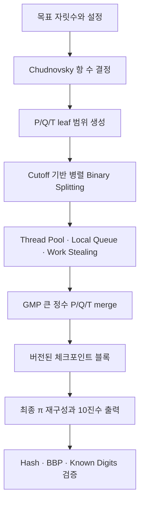

# PiEngine

PiEngine은 현대적인 C++20으로 만드는 고성능 CPU 기반 원주율 계산기입니다.

목표는 단순히 작은 자릿수의 π를 빠르게 출력하는 것이 아닙니다. 수십억 자리
이상의 장시간 계산을 멀티코어에서 수행하면서, 중단 후 재시작하고 RAM 한계를
넘겨 계산하며, 마지막 결과를 독립적으로 검증할 수 있는 계산 엔진을 지향합니다.

프로젝트의 설계 방향을 한 문장으로 요약하면 다음과 같습니다.

> **Checkpointable Parallel Chudnovsky Binary Splitting**

> [!IMPORTANT]
> `pi-engine`은 병렬 Chudnovsky 계산, out-of-core 저장, interval-gated
> checkpoint 생성, 검증된 block 기반 resume, 진행 보고, 최종 결과 기록과
> 검증을 하나의 실행 경로로 연결합니다. 손상되거나 manifest에 없는 block은
> 계산에 사용하지 않고 격리한 뒤 해당 범위를 다시 계산합니다.

## 목표

- Chudnovsky 공식으로 수십억 자리 이상의 π 계산
- Binary Splitting과 work stealing을 통한 CPU 멀티코어 활용
- GMP에 큰 정수 연산과 FFT multiplication 위임
- P/Q/T 블록 체크포인트를 이용한 중단 후 재시작
- OS swap에 의존하지 않는 전용 out-of-core 저장 계층
- CLI뿐 아니라 JSON, GUI, metrics로 확장 가능한 진행 상태 모델
- checksum, 독립 modular P/Q/T 검증, known digits, hash, BBP 검증
- 정확성 → 안정성 → 유지보수성 → 성능 순서의 개발 원칙

## 전체 계산 방향



계산 worker는 P/Q/T 연산만 담당합니다. 체크포인트 I/O와 진행 상태 출력은
별도 경로로 분리하여 느린 디스크나 reporter가 계산 worker를 막지 않게 만드는
것이 목표입니다.

## 핵심 알고리즘

### 1. Chudnovsky 공식

PiEngine의 π 급수는 Chudnovsky 공식을 사용합니다.

```math
\frac{1}{\pi}
=
12\sum_{k=0}^{\infty}
\frac{(-1)^k(6k)!(13591409+545140134k)}
{(3k)!(k!)^3(640320)^{3k+\frac{3}{2}}}
```

한 항은 약 14.18자리의 정밀도를 추가합니다. 목표가 $D$자리라면 필요한 항의
수는 대략 다음과 같습니다.

```math
N=\left\lceil\frac{D}{14.1816474627}\right\rceil
```

직접 앞에서부터 항을 더하지 않고 Binary Splitting으로 평가하여 큰 정수의
불필요한 성장을 줄이고 독립적인 하위 범위를 병렬 작업으로 만듭니다.

### 2. Binary Splitting과 P/Q/T

범위 $[a,b)$의 결과는 세 개의 큰 정수 $P(a,b)$, $Q(a,b)$, $T(a,b)$로
표현합니다. 중간점 $m$에서 왼쪽과 오른쪽 결과는 다음처럼 병합됩니다.

```math
P(a,b)=P(a,m)P(m,b)
```

```math
Q(a,b)=Q(a,m)Q(m,b)
```

```math
T(a,b)=T(a,m)Q(m,b)+P(a,m)T(m,b)
```

현재 P/Q/T 자료구조, Chudnovsky leaf, `[start, end)` 범위 검증, cutoff
기반 staged parallel DAG와 parallel merge, integer fixed-point 최종 계산과
decimal formatting이 구현되어 있습니다.

분할 트리의 깊이는 $O(\log N)$입니다. $M(n)$을 $n$비트 정수 곱셈 비용이라고
할 때 전체 급수 계산 비용은 큰 정수 곱셈에 지배되며, Binary Splitting 기반
평가는 일반적으로 $O(M(n)\log^2 n)$ 범위의 계산을 목표로 합니다. 실제 성능과
메모리 피크는 cutoff, GMP 알고리즘 선택, 동시에 유지하는 subtree 수에 따라
달라지므로 benchmark로 결정합니다.

### 3. GMP 큰 정수 연산

PiEngine은 자체 Big Integer나 FFT/NTT multiplication을 다시 구현하지
않습니다. `GMPInteger`가 GMP의 `mpz_t`를 소유하고 P/Q/T의 덧셈, 뺄셈,
곱셈을 `mpz_*` 연산에 위임합니다.

GMP는 피연산자 크기에 따라 기본 곱셈, Karatsuba, Toom-Cook, FFT 계열
알고리즘을 선택합니다. PiEngine의 멀티코어 전략은 먼저 Binary Splitting의
독립 subtree를 병렬 실행하는 것입니다. 하나의 거대한 `mpz_mul`이 항상 모든
코어를 사용한다고 가정하지 않으며, 상위 merge 단계의 병렬성 한계는 실제
benchmark 이후 최적화합니다.

### 4. Thread Pool과 Work Stealing

현재 scheduler 기반은 구현과 동시성 검증이 완료되어 있습니다.

- 고정된 worker thread pool
- 외부 제출용 bounded MPMC `LockFreeQueue`
- worker가 생성한 child 작업용 local `WorkStealingQueue`
- idle worker가 다른 worker의 local 작업을 가져오는 work stealing
- `TaskHandle` 기반 wait, 완료·실패 확인, 예외 전달
- `Stopped → Running → Stopping → Stopped` 수명주기
- stop 이전에 승인된 모든 작업을 끝내는 drain shutdown
- stop 시작 이후 신규 제출 거부

알고리즘 코드가 직접 thread를 만들지 않고 scheduler에 작업을 제출하는 구조를
유지합니다. 실제 steal 테스트는 root worker를 차단한 상태에서 local child가
복수의 다른 worker thread에서 실행되는 것까지 검증합니다.

### 5. 체크포인트와 무결성

대규모 계산은 재귀 호출 스택이 아니라 독립적으로 병합 가능한 P/Q/T 범위를
체크포인트로 저장합니다.

각 블록은 다음 정보를 포함합니다.

- 파일 magic과 format version
- 계산 identity와 목표 자릿수
- Chudnovsky 범위 `[a, b)`와 tree level
- P/Q/T payload 길이와 값
- checksum 종류와 checksum 값
- 완료 상태와 manifest 연결 정보

블록은 임시 파일에 기록하고 flush·동기화한 다음 atomic rename으로 완료합니다.
재시작 시에는 구조, 범위, checksum, manifest 일관성뿐 아니라 별도 modular
P/Q/T residue까지 통과한 블록만 재사용합니다. 손상된 블록은 격리하고 해당
범위를 다시 계산합니다.

### 6. Out-of-Core와 진행 상태

RAM이 부족할 때 OS swap에 의존하지 않고 명시적인 out-of-core merge와 저장
정책을 사용합니다. 진행 상태는 계산 로직이 문자열을 직접 출력하지 않고,
thread-safe tracker가 immutable snapshot을 제공하는 구조로 확장합니다.

snapshot에는 phase, 목표 자릿수, 완료 항 수와 블록 수, pipeline·phase 작업량,
merge level, active/queued task, 처리 속도, 전체 완료 ETA, 현재 단계 ETA,
메모리, storage chunk와 I/O, checkpoint telemetry가 포함됩니다. CLI text와
JSON reporter는 같은 snapshot을 소비합니다.

Checkpoint telemetry는 서로 다른 네 가지 개념을 구분합니다.

- **완료 작업**(`checkpoints=C/T`, JSON `checkpoint_blocks.completed/total`):
  검증을 통과해 재사용한 resume 블록과 새로 계산한 초기 frontier 블록의 수입니다.
  단조 증가하며, 고정된 total(재사용 블록 + 재계산 예정 leaf 블록)을 넘지 않습니다.
- **Durable 블록**(`durable=D`, JSON `checkpoint_blocks.durable`): 현재
  manifest의 entry 수입니다. 자식 블록이 병합된 부모로 교체되면 **감소할 수
  있습니다**. `checkpoint_bytes`는 현재 manifest가 참조하는 블록 파일 크기의
  정확한 합이며 manifest 자체와 참조되지 않은 파일은 제외합니다.
- **검증된 블록**(`last_validated=`, JSON `last_validated_checkpoint`): resume
  시 구조·checksum·manifest·modular P/Q/T 검증을 통과한 입력에만 설정됩니다.
- **커밋된 블록**(`last_committed=`, JSON `last_committed_checkpoint`): 새로
  기록된 마지막 블록으로, 이를 참조하는 manifest가 atomic하게 게시된 뒤에만
  갱신됩니다. 새로 기록된 블록은 검증된 블록으로 표시하지 않습니다.

Checkpoint telemetry는 manifest 교체가 성공한 뒤 coordinating thread에서 한
번에 게시됩니다. 실패했거나 interval 때문에 생략됐거나 내용이 같은 commit은
telemetry를 바꾸지 않습니다. JSON progress `schema_version`은 6입니다.

Progress ETA는 기본적으로 output writing과 선택된 final verification까지 남은
전체 시간을 표시합니다. `--eta-total`은 전체 ETA만, `--eta-phase`는 현재
단계 ETA만 선택하며 두 옵션을 함께 주면 두 값을 모두 표시합니다. 충분한
관측 표본이 생기기 전에는 선택된 ETA가 `unknown`/`null`이고, 완료 시 0,
실패 시 `unknown`/`null`입니다.

PR-0038부터 ETA는 관측 증거로만 계산합니다. 현재 단계 속도는 단계 진입부터
마지막 작업 단위가 게시된 시점까지로 측정하므로, counter가 바뀌지 않는 동안
두 ETA는 흐른 시간만큼 정확히 줄어들고 시간이 지난다는 이유만으로 늘어나지
않습니다. 예측 시각을 넘긴 단계는 0이 아니라 `overdue`로 표시됩니다. 이후
단계는 이미 끝난 단계의 실제 소요 시간을 그 단계들의 계획 비용으로 나눈
보정값으로 환산하며, 끝난 단계가 없으면 현재 단계의 측정 속도를 씁니다.
resume으로 복원된 작업은 보정에서 제외됩니다. Merge 작업 단위는 level마다
`min(workers, pairs)`로 나눕니다. Verification decimal import는 1,048,576자리
leaf를 GMP로 변환한 뒤 균형 트리로 합치는 실제 leaf/merge 비용을 사용하고,
독립 BBP sample 비용은 `min(workers, samples)`로 나눕니다. JSON progress
schema version 6은
`estimated_total_time_remaining_ns`, `estimated_phase_time_remaining_ns`와 함께
`eta_total_basis`(`measured`, `calibrated_plan`, `overdue`, `unknown`)와
`eta_phase_overdue`를 제공하며, 선택되지 않은 ETA의 두 field는 `null`입니다.
Text 출력은 `eta_total=overdue`, `eta_phase=overdue`로 표시합니다.

#### FAQ: 대규모 계산에서 `eta_total=unknown`이 오래 표시되는 이유

`unknown`은 전체 작업량을 모른다는 의미가 아니라 ETA를 계산할 만큼 완료된
작업 표본이 아직 없다는 의미입니다. 현재 단계에서 새 작업 단위가 1개 이상
완료되고, 단계 진입부터 마지막 완료 단위까지 측정 구간이 1초 이상이어야
현재 단계의 속도 표본을 사용합니다.

Binary Splitting 진행량은 각 term이 아니라 leaf block 전체가 완료될 때
게시됩니다. leaf block 수는 최대 `worker 수 * tasksPerWorker`이고 기본
`tasksPerWorker`는 4입니다. 따라서 수백억 자리 계산에서는 첫 block이
완료될 때까지 `terms=0/...`과 `eta_total=unknown`이 오래 유지될 수 있습니다.

| 관측 상태 | 의미 |
| --- | --- |
| `phase=splitting`, `terms=0/...` | 첫 leaf block 완료 대기 |
| `phase=splitting`, `terms>0` | 측정 구간 조건까지 충족되면 ETA 표시 |
| `phase=initializing` 또는 `phase=validating_checkpoints` | 현재 단계의 ETA 표본이 아직 없음 |
| `phase=failed` | 실패한 계산에는 ETA를 제공하지 않음 |
| CPU 사용률과 `active_tasks`가 유지됨 | 작업이 계속 실행 중이라는 보조 증거 |

`unknown`은 관측 증거가 부족한 상태이고, `overdue`는 기존 예측 시간을
초과한 상태이므로 서로 다릅니다. ETA는 관측 기반 추정값이며 완료 시각을
보장하지 않습니다.

## 현재 구현 상태

| 영역 | 상태 | 현재 범위 |
| --- | --- | --- |
| 설정과 CLI | 완료 | TOML/default/CLI override, `-h`/`--help`, 알 수 없는 옵션 거부(종료 상태 2), 병렬 계산, 결과 기록과 검증 |
| Logger | 기반 완료 | 동기식 한 줄 stderr logger, resume 진단 warning(progress 시작 전) |
| Platform | 기반 완료 | CPUID와 AVX/AVX2/AVX-512 기능 탐지 |
| Memory | 기반 완료 | Arena, pool, alignment, scratch buffer |
| Scheduler | 완료 | lifecycle, drain, MPMC queue, local routing, work stealing |
| Big Integer | 기반 완료 | GMP `mpz_t` RAII wrapper와 기본 산술 |
| Binary Splitting | 완료 | P/Q/T node, 순차 계산, staged parallel merge |
| Chudnovsky leaf | 완료 | leaf 공식, 범위 검증, known P/Q/T와 pi 앞자리 검증 |
| 병렬 Binary Splitting | 완료 | 명시적 cutoff, bounded leaf block, 단계별 merge, fallback |
| Chudnovsky finalization | 완료 | precision plan, integer sqrt/division, rounded decimal API |
| Storage·out-of-core | 완료 | 동기·비동기 spill/reload, concurrent I/O, LZ4 |
| Checkpoint·무결성 | 완료 | interval-gated merge frontier, atomic manifest, verified resume, quarantine, 자동 CLI 중단·resume 회귀 테스트 |
| Progress reporting | 완료 | immutable snapshot, CLI text/JSON schema v6, 증거 기반 전체·단계 ETA 선택, text ETA 단위·정밀도 선택, live checkpoint telemetry, 기본·resume 완료 증거 |
| 최종 결과 검증 | 완료 | streaming hash, BBP spot check, known digits, manifest |

세부 구현 순서는 [Implementation Plan](docs/IMPLEMENTATION_PLAN.md), 완료 상태는
[Roadmap](docs/ROADMAP.md)과 [Checklist](docs/CHECKLIST.md), 설계 근거는
[Architecture Decisions](docs/DECISIONS.md)에서 확인할 수 있습니다.

## 하지 않는 것

- GMP와 중복되는 자체 Big Integer·FFT multiplication 구현
- 알고리즘 내부의 임시 thread 생성 또는 detached thread
- OS swap을 대규모 계산의 저장 전략으로 사용
- checksum만 통과한 checkpoint를 수학적으로 옳다고 간주
- benchmark 없이 cutoff, NUMA, SIMD, Huge Page 최적화 확정
- 아직 연결되지 않은 기능을 완료된 π 계산 기능으로 표시

## 빌드

### 요구 사항

- CMake 3.20 이상
- C++20 컴파일러(GCC 또는 Clang)
- GMP 개발 패키지
- LZ4 개발 패키지(`liblz4`; Debian/Ubuntu `liblz4-dev`, Arch `lz4`)
- POSIX thread 지원 환경
- Git

`toml++`는 `third_party/tomlplusplus`에 포함되어 있습니다.

프로젝트 루트에서 실행합니다.

```bash
cmake -S . -B build -DCMAKE_BUILD_TYPE=Release
cmake --build build --parallel
```

빌드가 완료되면 다음 실행 파일이 생성됩니다.

```text
build/pi-engine
```

소스를 갱신(`git pull` 등)한 뒤에는 이전 실행 파일이 남아 있을 수 있으므로
`cmake --build build --parallel`로 다시 빌드한 다음 `build/pi-engine`을
실행합니다. 오래된 실행 파일로는 최신 progress·checkpoint 동작을 확인할 수
없습니다.

실행 파일은 π를 계산해 결과 파일에 기록하고, 기본 설정에서는 결과 검증과
verification manifest 저장까지 수행합니다. `--threads 0`은 사용 가능한 hardware
thread 수를 자동 선택합니다.

```bash
./build/pi-engine --digits 1000000 --threads 0
```

기본 출력은 `pi.txt`, verification manifest는 `pi.txt.verify`입니다. 출력 경로를
바꾸면 manifest 기본 경로도 `<output>.verify`가 됩니다.

```bash
./build/pi-engine \
  --digits 1000000 \
  --output /data/pi/pi.txt \
  --verification-manifest /data/pi/pi.verify \
  --bbp-samples 8
```

`--no-verify`로 최종 검증을 끌 수 있습니다. `--bbp-samples`는 1~32이며 기본값은
8입니다.

PR-0048부터 파일의 10진 fraction은 1,048,576자리 leaf로 나눠 GMP
`mpz_set_str`로 변환하고 이진 트리로 합칩니다. 계산이 끝나 정지한 scheduler는
BBP 단계에서 다시 시작되며, 독립 sample을 최대
`min(--threads, --bbp-samples)`개 동시에 검증합니다. 결과와 diagnostic 순서,
progress 게시 순서는 sample 위치 순서로 결정되므로 worker 완료 순서와
무관합니다.

### 도움말과 종료 상태

`-h` 또는 `--help`는 지원하는 옵션을 Calculation, Output, Checkpoint and
resume, Progress, Out-of-core storage, Final verification, General 그룹으로
나누어 내장 기본값, 허용 값·단위, 설정 우선순위, 경로 해석 규칙, 예시와 함께
stdout에 출력하고 종료 상태 0으로 끝납니다. 도움말은 `config.toml`을 읽거나
검증하지 않으며 계산하지 않고 파일·디렉터리도 만들지 않습니다.

```bash
./build/pi-engine --help
```

옵션 값은 항상 별도 인자로 전달합니다(`--digits 1000`, `--digits=1000`은 지원하지
않음). 같은 옵션을 반복하면 마지막 값이 적용됩니다. 인자는 왼쪽부터 해석하며
`-h`/`--help`를 만나면 그 뒤 인자는 해석하지 않습니다.

| 종료 상태 | 의미 |
| --- | --- |
| 0 | 계산 성공 또는 도움말 출력 |
| 1 | `config.toml` 오류, 설정 검증 실패(예: `--bbp-samples 33`), 계산·I/O·검증 실패 |
| 2 | 명령줄 사용 오류: 알 수 없는 옵션, 값 누락, 정수·`text`/`json`으로 해석할 수 없는 값 |

알 수 없는 옵션은 더 이상 무시되지 않습니다. 예를 들어 `--digit` 오타는
`config.toml`을 읽기 전에 거부되며 stderr에 다음을 출력하고 종료 상태 2로
끝납니다.

```text
pi-engine: unknown option: --digit
Try 'pi-engine --help' for usage.
```

### 설정 우선순위

실행 시 현재 작업 디렉터리의 `config.toml`을 읽습니다. 파일이 없으면 내장
기본값을 사용하고, CLI 옵션은 TOML 값을 덮어씁니다(내장 기본값 → `config.toml`
→ CLI 옵션 순으로 나중 값이 우선).

```bash
cp config.toml.example config.toml
./build/pi-engine --digits 1000000
```

### Checkpoint와 resume

기본값은 checkpoint와 resume 활성화, `checkpoints`와
`checkpoint-quarantine` 디렉터리, 300초 interval입니다. 같은 계산 identity로
다시 실행하면 검증을 통과한 durable block만 자동 재사용하고, 손상되거나
manifest에 없는 block은 quarantine한 뒤 해당 범위를 다시 계산합니다.

PR-0034부터 resume 검증에서 block이 거부되거나 manifest 진단이 생기면 progress가
시작되기 **전에** stderr로 `pi-engine: warning: checkpoint: ...` 형식의 한 줄
warning을 출력합니다.
거부된 block 경로(`rejected <path>`), 검증 단계·사유(`<stage>/<reason>: <detail>`),
격리 위치(`quarantined <path> to <path>`)가 각각 한 줄로 기록되며, 계산은 해당
범위를 다시 계산한 뒤 정상적으로 완료됩니다. 거부된 block이 없는 새 실행에서는
이 warning을 출력하지 않습니다. logger는 resume 진단에만 쓰이며 progress
record, stdout 결과, 도움말, 사용 오류 진단, 종료 상태(0/1/2)는 바뀌지 않습니다.

상대 경로(`checkpoints`, `checkpoint-quarantine`, `storage`, `pi.txt` 등)는
실행 파일 위치나 소스 트리가 아니라 **프로세스의 현재 작업 디렉터리** 기준으로
해석됩니다. 예를 들어 `/data/run`에서 `/path/to/repo/build/pi-engine`을 실행하면
checkpoint는 `/data/run/checkpoints/`에 기록됩니다. 다른 디렉터리에서 다시
실행하면 기존 checkpoint를 찾지 못하므로 같은 작업 디렉터리에서 resume하거나
절대 경로를 지정합니다.

PR-0032부터 checkpoint 작업 계획은 checkpoint writer가 있을 때만
재계산 블록을 포함합니다. `--no-checkpoint --resume`(resume 전용)은 검증을 통과한
기존 블록만 완료 작업으로 표시하고, 재사용할 블록이 없으면 `checkpoints=0/0`을
보고하며 checkpoint 파일을 만들지 않습니다.

```bash
./build/pi-engine --checkpoint --resume \
  --checkpoint-directory checkpoints \
  --checkpoint-quarantine-directory checkpoint-quarantine \
  --checkpoint-interval 300
```

기존 checkpoint를 사용하지 않고 새 계산을 시작하거나 checkpoint 자체를
비활성화할 수 있습니다.

```bash
./build/pi-engine --checkpoint --no-resume --digits 1000000
./build/pi-engine --no-checkpoint --no-resume --digits 1000000
```

#### 낮은 정밀도 checkpoint 승격 (PR-0041)

`--promote-checkpoint-manifest <path>`는 더 낮은 자릿수로 완료한 계산의
manifest를 명시적으로 지정해, 그 P/Q/T frontier를 더 높은 자릿수 계산의 초기
frontier로 가져옵니다. 남은 term 범위만 새로 계산하며 출력은 처음부터 계산한
결과와 바이트 단위로 같습니다. 명령줄 전용이며 checkpoint와 resume이 모두
켜져 있어야 합니다.

```bash
./build/pi-engine --digits 10000000 \
  --checkpoint-directory checkpoints-10m \
  --promote-checkpoint-manifest checkpoints-5m/manifest-v1-...-d5000000-....manifest
```

- source manifest와 block은 읽기만 합니다. 하나라도 구조·checksum·수학 검증에
  실패하거나 source 자릿수와 term 수가 대상보다 작지 않으면 전체 승격을
  거부하고 종료 상태 1로 끝납니다. source 파일은 quarantine되거나 바뀌지
  않습니다.
- source와 대상 checkpoint 디렉터리는 달라야 합니다. 같으면 대상 resume
  검증이 source 파일을 격리하기 전에 거부합니다. manifest를 파일명만으로
  지정하면 현재 작업 디렉터리 기준으로 해석합니다.
- 첫 대상 checkpoint commit은 가져온 block을 대상 identity로 다시 기록하며,
  대상 manifest는 source identity block을 참조하지 않습니다. 형식은 version
  1 그대로입니다.
- 대상 디렉터리에 이미 검증된 대상 checkpoint가 있으면 승격은 충돌로
  거부됩니다. 승격 실행이 중단된 뒤에는 `--promote-checkpoint-manifest` 없이
  같은 명령으로 다시 실행해 일반 resume으로 이어갑니다.

### Progress 출력

진행 상태는 기본으로 500 ms마다 text 형식으로 **stderr**에 출력됩니다. JSON
형식은 한 줄당 하나의 schema version 4 record인 JSONL입니다.

PR-0032 기준 동작은 다음과 같습니다.

- 대화형 터미널(TTY) stderr에서는 한 줄을 갱신하는 compact record를 출력하며,
  log 전용 storage·I/O 진단(`storage=`, `io=`)은 생략합니다.
- stderr가 파일이나 pipe이면(non-TTY) 시각이 붙은 줄 단위 전체 record를
  출력하며 storage·I/O 진단을 모두 포함합니다. JSON schema version 4 record도
  모든 field를 유지합니다.
- 기본 설정으로 성공한 실행의 마지막 record는 `phase=completed`, `terms=N/N`,
  0이 아닌 완료 checkpoint 작업(`checkpoints=C/C`), `durable=` 블록 수와
  `checkpoint_bytes`를 보여 주며, 작업 디렉터리의 `checkpoints/`에 manifest와
  root checkpoint block이 남습니다.
- progress reporter가 실패하면 CLI는 오래된 progress를 둔 채 성공으로 끝내지
  않고 실패 상태로 종료합니다.
- Text ETA는 `--eta-unit <auto|min|hour>`(기본 `auto`)와
  `--eta-precision <digits>`(0~9, 기본 2)로 표시 형식을 정합니다. `auto`는
  60초 미만을 `sec`, 60분 미만을 `min`, 그 이상을 `hour`로 표시하며 경계는
  반올림 전 실제 시간으로 판단합니다. `min`과 `hour`는 단위를 바꾸지 않습니다.
  값은 classic locale의 고정 소수점(예: `eta_total=12.50min`)이고 `unknown`과
  `overdue`는 그대로입니다. 두 옵션은 command line 전용(TOML key 없음)이며
  JSON ETA는 정수 nanosecond와 schema version 6을 유지합니다. 정수가 아닌
  precision은 usage error(종료 상태 2), 10 이상은 설정 검증 실패(종료 상태
  1)입니다.

```bash
./build/pi-engine --progress --progress-interval 500 --progress-format json \
  2>progress.jsonl
./build/pi-engine --no-progress
./build/pi-engine --eta-total --eta-phase --eta-unit hour --eta-precision 4
```

### Out-of-core 저장

Out-of-core 저장은 기본 활성화되어 `storage/`를 사용합니다. 기본 memory budget은
512 MiB, 목표 chunk 크기는 64 MiB, 최대 동시 I/O는 1, compression은 LZ4입니다.
프로덕션 실행은 설정된 디렉터리의 `.pi-engine-runtime.lock`을 실행 동안
배타적으로 유지하고, 실제 임시 chunk와 index는 매 실행마다 새로 만드는
`.pi-engine-active/` 아래에 둡니다. 이전 비정상 종료의 runtime chunk는 다음
실행에서 제거되며 checkpoint 또는 resume 근거로 사용되지 않습니다. 같은
storage 디렉터리를 동시에 사용하는 두 번째 프로세스는 명확한 오류로
거부됩니다. Checkpoint 디렉터리와 파일은 이 정리 대상에 포함되지 않습니다.


```bash
./build/pi-engine \
  --storage-directory /data/pi/storage \
  --storage-memory-budget-bytes 536870912 \
  --storage-chunk-size-bytes 67108864 \
  --storage-max-concurrent-io 1
```

Chunk 크기는 memory budget 이하여야 합니다. `out_of_core` 활성화와
`compression = "none" | "lz4"` 선택은 현재 `config.toml`에서만 바꿀 수
있습니다.

## 테스트

프로젝트 루트에서 전체 테스트를 실행합니다.

```bash
ctest --test-dir build --output-on-failure
```

테스트에는 실제 `pi-engine`을 첫 manifest 게시 뒤 중단하고 같은 identity로
resume한 다음, 중단 없이 계산한 결과와 decimal 출력 및 verification hash가
byte 단위로 같은지 비교하는 Linux 전용 CLI 회귀 테스트가 포함됩니다.
또한 실제 `pi-engine`을 별도 작업 디렉터리에서 실행해 `-h`/`--help`의 동일한
stdout·종료 상태 0, 잘못된 `config.toml`이 있어도 도움말과 사용 오류가 파일을
만들지 않는 점, 알 수 없는 옵션·값 누락·잘못된 값의 stderr와 종료 상태 2,
설정 오류의 종료 상태 1, CLI override가 `config.toml` 값보다 우선하는 점을
확인하는 Linux 전용 CLI 옵션 회귀 테스트(`CommandLineCliTest`)가 포함됩니다.

### Benchmark workflow

GitHub Actions의 `PiEngine Benchmarks` workflow는 수동으로 실행합니다. Release
설정과 `ENABLE_BENCHMARKS=ON`으로 기존 benchmark 5개를 빌드하고 제한된
workload를 실행한 뒤 원시 출력을 artifact로 보존합니다. 공유 runner의 실행
시간은 정보성 측정값이며 pull request 통과 조건이나 성능 회귀 임계값으로
사용하지 않습니다.

로컬에서 같은 빠른 계산·검증 profile을 실행하려면 다음을 사용합니다.

```bash
cmake -S . -B build-benchmark \
  -DCMAKE_BUILD_TYPE=Release \
  -DENABLE_BENCHMARKS=ON
cmake --build build-benchmark --parallel
./build-benchmark/chudnovsky-benchmark --quick
./build-benchmark/final-verification-benchmark --quick
```

`final-verification-benchmark --import-file <path> <digits> <leaf-digits>`는
파일 import만 측정하고, `--verify-file <path> <digits> <guard> <working>
<terms>`는 13-worker scheduler를 사용한 전체 파일 검증을 측정합니다.

### Source release

`v0.13.0`부터 release workflow는 CMake project version, tag, changelog
version이 정확히 일치하는지 확인합니다. Tagged source를 Release로 build하고
별도 Debug build에서 전체 CTest를 실행한 뒤 `givemepi-<version>.tar.gz`와
SHA-256을 만듭니다. 압축을 푼 별도 디렉터리에서도 같은 검증을 반복합니다.

Release asset은 source archive와 `SHA256SUMS`뿐입니다. 현재 실행 파일은
`-march=native`로 빌드되고 system GMP·LZ4에 동적 링크되므로 portable binary로
배포하지 않습니다. Repository의 toml++ 경로는 `.gitmodules` 없는 pinned
gitlink이므로 release workflow가 기록된 commit을 정확히 가져와 source archive
안에 포함합니다.

다운로드 후 다음처럼 무결성을 확인합니다.

```bash
sha256sum --check SHA256SUMS
```

Sanitizer 빌드는 다음처럼 구성할 수 있습니다.

```bash
cmake -S . -B build-sanitize \
  -DENABLE_ASAN=ON \
  -DENABLE_UBSAN=ON
cmake --build build-sanitize
ASAN_OPTIONS=detect_leaks=0 \
  ctest --test-dir build-sanitize --output-on-failure
```

## 문서

- [Implementation Plan](docs/IMPLEMENTATION_PLAN.md)
- [Architecture Decisions](docs/DECISIONS.md)
- [Roadmap](docs/ROADMAP.md)
- [Checklist](docs/CHECKLIST.md)
- [Changelog](docs/CHANGELOG.md)
- [Workflow](docs/WORKFLOW.md)
